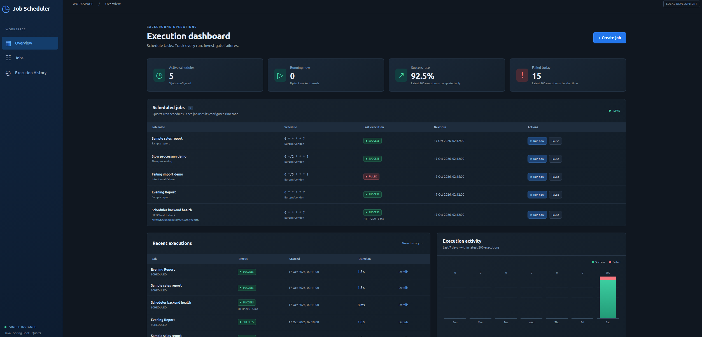
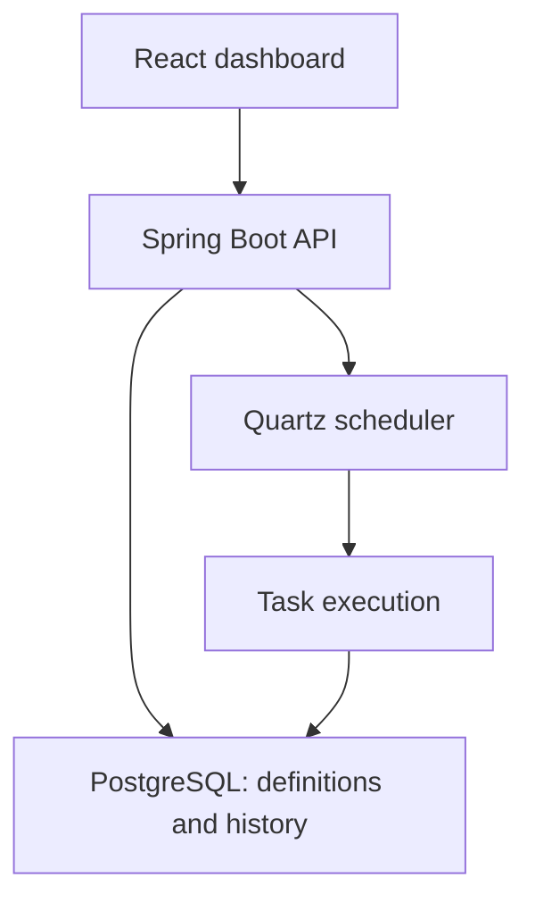

# Java Job Scheduler & Execution Dashboard

A Spring Boot / Quartz application with a React operations dashboard. Create recurring tasks, trigger manual runs, inspect successes and failures, and pause schedules without losing execution history.

## Dashboard Preview



## Start the complete application

Requires Docker Desktop or Docker Engine with the Compose plugin. From this directory:

```bash
docker compose up --build -d
```

Open **http://localhost:23473**. The first image build downloads dependencies and runs the backend tests. The dashboard may briefly show a connection error while the backend finishes starting; it refreshes automatically.

- Dashboard: http://localhost:23473
- Backend API: http://localhost:28473/api/jobs
- Backend health: http://localhost:28473/actuator/health
- PostgreSQL: localhost:25473 (database/user `scheduler`, development password `scheduler_dev`)

Ports 23473/28473/25473 help avoid clashes with existing projects. All host ports bind to loopback. This is a local development application with no authentication; don't expose it publicly.

```bash
docker compose logs -f backend
docker compose down
```

The database volume survives `down`. **`docker compose down -v` deletes the database and all history.**

## Try the first milestone

1. The initial startup seeds three clearly named demo jobs. Click **Run now** on Sample sales report and watch RUNNING become SUCCESS.
2. Run Failing import demo. Open its **Details** from recent executions to see the intentional error.
3. Run Slow processing demo to see a task remain RUNNING for 12 seconds.
4. Use **Create job**, choose a task, and select **Every minute**. Wait for the next minute boundary to see a SCHEDULED execution.
5. Pause a job: its next execution disappears. Resume it to restore the schedule.
6. Restart the backend. Definitions/history remain, schedules are reconstructed from PostgreSQL.

The three demo task types simulate successful, slow, and failed work.
HTTP_HEALTH_CHECK performs real GET requests against configured endpoints
and records their HTTP status and response time.
See [HTTP health checks](README_HTTP_CHECKS.md) for configuration details.

## Implemented

- Job creation with server-side cron/timezone validation.
- Timezone-aware Quartz cron schedules and four worker threads.
- Manual execution, pause/resume, no overlapping executions of the same job.
- Flyway-managed PostgreSQL job definitions and execution history.
- Start time, finish time, duration, trigger source, and useful result/error messages.
- Automatic 3-second dashboard polling; history filtering and execution details.
- Activity chart and summary statistics explicitly scoped to the latest 200 executions.
- Startup reconciliation: interrupted executions are marked INTERRUPTED; persisted definitions rebuild schedules.
- Integration tests and GitHub Actions CI.
- Configurable HTTP health checks with expected status codes, timeouts, response times, and diagnostic error categories.

## Architecture and deliberate boundaries



This milestone runs **one backend instance**. Job definitions and history persist; Quartz itself uses an in-memory store reconstructed at startup. This is not clustered scheduling or durable execution queuing. Requests queued in Quartz can be lost on restart. Do not scale backend replicas: each would independently schedule the same definitions.

`@DisallowConcurrentExecution` serializes runs by Quartz JobKey. Different jobs can run concurrently. Repeated manual requests can queue additional runs. Pausing removes future cron firings and blocks new manual requests; it does not cancel a currently running or already queued execution. A missed cron firing is skipped rather than replayed after downtime. Executions are not guaranteed exactly once.

Recording start and finish happens in separate committed transactions. If the process crashes during work, startup marks the unfinished run INTERRUPTED. Its actual duration is unknown, so it remains null. This is intentionally honest reporting rather than assuming failure or success.

Europe/London is the default per-job timezone and the dashboard display timezone; the API stores instants. Quartz interprets cron in each job's timezone, including daylight-saving transitions. Expressions use **Quartz syntax** (seconds first), not five-field Unix cron.

Automatic retries, editing/deleting jobs, authentication, distributed workers, alerting, durable Quartz JDBC queues, and history retention are future milestones. The first version offers manual reruns of enabled jobs.

## Local development without containerizing the applications

Requires Java 21, Maven 3.9+, Node 22.12+ (or compatible newer version), and Docker for PostgreSQL.

```bash
# Project root
docker compose up -d db

# Terminal 1
cd backend
mvn spring-boot:run

# Terminal 2 (from project root)
cd frontend
npm ci
npm run dev
```

Open http://localhost:5173. Vite proxies `/api` to localhost:8080. The backend's default datasource uses localhost:25473. Database settings can be overridden with `DB_URL`, `DB_USER`, `DB_PASSWORD`; disable seeding with `SEED_DEMO_JOBS=false`.

## Verification

```bash
mvn -B -f backend/pom.xml verify
npm ci --prefix frontend
npm run build --prefix frontend
```

Backend integration tests use H2 in PostgreSQL compatibility mode and real Quartz workers, without Docker. Mockito uses its subclass mock maker so these tests do not require runtime agent attachment. They cover validation, automatic cron firing, manual success/failure, serialization, pause/resume, missing jobs, pagination limits, and restart recovery. H2 does not replace a PostgreSQL/Docker smoke test.

## API

| Method | Path | Purpose |
|---|---|---|
| GET | `/api/jobs` | Definitions, next run and last execution |
| POST | `/api/jobs` | Create and schedule a job |
| POST | `/api/jobs/{id}/run` | Request manual execution (202) |
| PUT | `/api/jobs/{id}/enabled` | Pause/resume with `{"enabled":false}` |
| GET | `/api/executions?limit=50&jobId=...` | Recent executions, optional job filter; limit 1–200 |

```bash
curl -i -X POST http://localhost:28473/api/jobs \
  -H 'Content-Type: application/json' \
  -d '{"name":"Evening demo report","taskType":"REPORT_DEMO","cronExpression":"0 0 21 * * ?","zoneId":"Europe/London"}'
```

Task types: `REPORT_DEMO` (~1.8 seconds), `SLOW_DEMO` (~12 seconds),
`FAILURE_DEMO` (~1.2 seconds, intentional failure), and
`HTTP_HEALTH_CHECK` (real HTTP endpoint monitoring).
No arbitrary scripts or user-supplied executable code are run.

## Possible future enhancements

Job editing, PostgreSQL Testcontainers tests, bounded automatic retries,
and history retention. Quartz JDBC persistence could support a future
move towards clustered scheduling.